# EVENTFLARE — Enterprise Event Planning & Management Platform

[](https://github.com/prasajanravishka/Event-Planning-Management/actions)
[](https://laravel.com)
[](https://php.net)
[](/privacy)
[](LICENSE)
[](/tests)

**EVENTFLARE** is an industrial-grade, multi-tenant event planning and supplier coordination marketplace tailored for the Sri Lankan market. Built on modern enterprise patterns, it seamlessly connects event hosts (couples, corporate entities, birthday celebrants) with accredited, verified local vendors—including traditional Kandyan Poruwa artisans, concert-grade sound and lighting engineers, DJs, five-star luxury banquet hotels, wedding cinematographers, artisan bakers, security details, and mobile mixologists.

The platform provides end-to-end booking orchestration with dynamic 4-stage reservation wizards, real-time financial telemetry, automated PDF reservation dossiers, comprehensive supplier administration, executive moderation, and strict compliance with the **Sri Lanka Personal Data Protection Act (PDPA) No. 9 of 2022**.

---

## Table of Contents

- [Project Overview](#project-overview)
- [Features](#features)
- [Technology Stack](#technology-stack)
- [Project Structure](#project-structure)
- [Installation & Setup](#installation--setup)
- [Configuration & Environment Variables](#configuration--environment-variables)
- [Usage & Workflows](#usage--workflows)
  - [Seeded Demo Accounts](#seeded-demo-accounts)
  - [Core User Journeys](#core-user-journeys)
  - [Automated Test Suite](#automated-test-suite)
- [Contributing](#contributing)
- [License](#license)
- [Assumptions & Notes](#assumptions--notes)

---

## Project Overview

EVENTFLARE addresses the fragmented event management landscape in Sri Lanka by transforming manual, unstandardized coordination into a structured digital marketplace. Originally conceived as a procedural PHP web application, EVENTFLARE has been completely re-architected into an enterprise **Laravel 10 LTS MVC** application.

### Key Objectives & Purpose
- **Transparency**: Transparent pricing in Sri Lankan Rupees (LKR) with support for per-person catering rates, fixed package bundles, and hourly/daily rates.
- **Cultural & Modern Alignment**: Tailored workflows for Sri Lankan cultural celebrations (such as traditional Poruwa rituals, Ashtaka narrators, and Jayamangala Gatha choirs) as well as modern club DJ raves, milestone jubilee birthdays, beach gatherings, and five-star corporate galas.
- **Operational Efficiency**: Automated booking state machines (Pending $\rightarrow$ Confirmed $\rightarrow$ In Progress $\rightarrow$ Completed / Cancelled), vendor assignment workflows, instant downloadable PDF itineraries, and automated transactional emails.
- **Target Audience**:
  - **Event Hosts / Clients (Buyers)**: Individuals and corporate coordinators seeking reliable event suppliers and structured budgets.
  - **Suppliers & Vendors**: Local event professionals and service agencies managing service accreditations and commercial package listings.
  - **Platform Administrators**: Operations managers overseeing booking lifecycles, user moderation, review approvals, catalog definitions, and staff provisioning.

---

## Features

### 1. Multi-Role Security & Identity Management
- **Role-Based Access Control (RBAC)**: Strict middleware segregation enforcing boundaries across three discrete roles: `admin`, `supplier`, and `buyer`.
- **Brute-Force Protection & Audit Logging**: Login requests are rate-limited with IP tracking, browser user-agent capture, and persistent logging in the `login_attempts` audit table.
- **Inactivity Session Timeout**: Automated session invalidation following 2 hours (7,200 seconds) of user inactivity via custom `InactivityTimeoutMiddleware`.
- **Global Security Headers**: Protection against clickjacking and MIME-type sniffing using headers injected via `SecurityHeadersMiddleware` (`X-Frame-Options: SAMEORIGIN`, `X-Content-Type-Options: nosniff`, `X-XSS-Protection: 1; mode=block`, `Referrer-Policy: strict-origin-when-cross-origin`).

### 2. Multi-Stage Booking Wizard & Live Telemetry
- **Dynamic 4-Stage Reservation Flow**: Step-by-step booking configuration:
  1. *Host & Schedule*: Client identities, date validation, and daytime vs. night session selection.
  2. *Venue & Style*: Pre-configured banquet venues (Shangri-La, Kingsbury, Cinnamon Grand, Earl's Regency, etc.) and thematic styles (Traditional Poruwa, Western Elegance, Beachside, Palatial Ballroom).
  3. *Catering Intelligence*: Real-time base rates per guest tier (Platinum, Executive, Cocktail) with dynamic guest-multiplier calculations.
  4. *Artisan Packages & Extras*: Service add-ons (Poruwa decor, AV line arrays, photography, lighting) and custom notes.
- **Collision-Resistant Cryptographic IDs**: Automated generation of alphanumeric booking keys prefixed by category (e.g., `BKG-WED-XXXX`, `BKG-DJ-XXXX`, `BKG-BDAY-XXXX`, `BKG-HTL-XXXX`, `BKG-GET-XXXX`).
- **Atomic Database Transactions**: All bookings, service line items, and event extra details are wrapped in database transactions to guarantee data consistency.

### 3. Dynamic Marketplace & Search Engine
- **Multi-Factor Filtering**: Real-time filtering across keyword search (titles, descriptions, business names, categories), event category tags, geographical locations (Colombo, Kandy, Galle, Negombo), and LKR price ranges.
- **Flexible Pricing Models**: Supports `per_person`, `total_package`, `per_day`, and `per_hour` commercial pricing structures.

### 4. Client Event Hub & PDF Dossier Generation
- **Client Booking Ledger**: Track historical and active reservations with real-time status badges.
- **Automated PDF Export**: Single-click generation of professional reservation confirmation dossiers and vouchers powered by `barryvdh/laravel-dompdf`.
- **Vendor Endorsements**: Post-event star rating and review submission for completed bookings with administrator approval moderation.

### 5. Supplier Command Center
- **Vendor Business Profile**: Configure company branding, trade categories, contact telephone, operational locations, and logo uploads.
- **Accredited Services Sync**: Map supplier capabilities to standardized platform service categories.
- **Package Listing CRUD**: Full management of public marketplace listings with imagery, descriptions, capacity limits, and pricing structures.

### 6. Administrative Operations Console
- **Executive Telemetry**: High-level platform analytics including user counts, revenue metrics, booking volumes, and unread inquiries.
- **Reservation Ledger & Supplier Assignment**: Review booking dossiers, transition lifecycle states, and assign accredited vendors to specific service line items.
- **Catalog Management**: Dynamic creation and modification of master event types and service definitions with priority ranking.
- **Review Moderation**: Approve or hide customer reviews before they are displayed publicly.
- **Inquiry Management**: Inbox for contact desk inquiries with read/unread toggle controls.
- **Staff Provisioning**: Administrative account creation with bcrypt password hashing.

### 7. Catering Cost Intelligence (Food Calculator)
- Standalone and authenticated tool calculating buffet, beverage, dessert, and snack costs based on guest counts and unit prices.
- Computes budget variance and remaining funds, with optional persistence to the `budgets` ledger.

### 8. Transactional Notifications
- Automated HTML email notifications sent via Laravel Mailables:
  - `BookingConfirmationMail`: Sent to clients upon reservation submission.
  - `BookingStatusUpdatedMail`: Notifies clients when booking status changes (confirmed, in progress, completed, cancelled).
  - `SupplierAssignedMail`: Alerts vendors when assigned to an event service.
  - `NewContactInquiryMail`: Delivers customer inquiries directly to administrators.

### 9. Legal Compliance & Data Protection
- **Sri Lanka PDPA Compliance**: Fully aligned with the **Personal Data Protection Act No. 9 of 2022**, featuring lawful processing notices, user rights workflows, and Data Protection Officer (DPO) channels.
- **Cookie Consent Banner**: Floating banner with `localStorage` preference persistence.

---

## Technology Stack

| Layer | Technologies | Purpose |
| :--- | :--- | :--- |
| **Backend Core** | PHP 8.1 / 8.2, Laravel 10.x LTS | Application MVC framework, routing, Eloquent ORM |
| **Database** | MySQL 8.0 / MariaDB, SQLite (in-memory) | Relational storage with foreign key constraints; SQLite for automated tests |
| **Frontend & UI** | Blade Templating, Tailwind CSS 3.x, Alpine.js | Responsive interface, Glassmorphism design tokens, interactive components |
| **Asset Pipeline** | Vite 4.x, PostCSS, Autoprefixer | Front-end asset compilation, bundling, and hot reloading |
| **PDF Generation** | `barryvdh/laravel-dompdf` (Dompdf 3.1) | Server-side PDF generation for reservation vouchers and invoices |
| **Security & Auth** | Laravel Breeze, Custom Middleware, Bcrypt | Role authentication, CSRF validation, brute-force rate limits, security headers |
| **Testing** | PHPUnit 10.x, Pest Plugin support | 80+ automated unit and feature integration tests |
| **CI/CD** | GitHub Actions | Automated build, migration, and test matrix across PHP 8.1 & 8.2 with MySQL |

---

## Project Structure

An overview of the non-generated files and primary directories within EVENTFLARE:

```text
eventflare/
├── .editorconfig                       # Code style and indentation configurations
├── .env.example                        # Environment variables template
├── .gitattributes & .gitignore         # Git repository tracking rules
├── artisan                             # Laravel CLI runtime executable
├── CHANGELOG.md                        # Version history and upgrade notes (1.0.0-beta)
├── composer.json & composer.lock       # PHP dependencies, scripts, and PSR-4 autoload rules
├── LICENSE                             # MIT License terms
├── package.json & package-lock.json    # Frontend npm packages (Tailwind, Alpine, Vite)
├── phpunit.xml                         # Test runner configuration (SQLite in-memory test DB)
├── postcss.config.js                   # PostCSS plugin configurations
├── README.md                           # Project technical overview and developer guide
├── tailwind.config.js                  # Tailwind theme customizations
├── vite.config.js                      # Vite asset bundler configuration
│
├── .github/
│   └── workflows/
│       └── ci.yml                      # GitHub Actions CI matrix (PHP 8.1/8.2 + MySQL)
│
├── app/
│   ├── Console/
│   │   └── Kernel.php                  # Artisan command registry and scheduled tasks
│   ├── Exceptions/
│   │   └── Handler.php                 # Global exception logging and HTTP error responses
│   ├── Http/
│   │   ├── Controllers/
│   │   │   ├── Admin/                  # Administrative controllers (bookings, users, catalog, reviews)
│   │   │   │   ├── AdminBookingController.php
│   │   │   │   ├── AdminDashboardController.php
│   │   │   │   ├── AdminOperationsController.php
│   │   │   │   └── AdminUserController.php
│   │   │   ├── Auth/                   # Multi-role authentication, login rate-limiting, registration
│   │   │   │   ├── AuthenticatedSessionController.php
│   │   │   │   ├── RegisteredUserController.php
│   │   │   │   ├── SupplierRegisterController.php
│   │   │   │   └── ... (Password resets & verification controllers)
│   │   │   ├── Client/                 # Client booking engine, dashboard, and PDF export
│   │   │   │   ├── BookingController.php
│   │   │   │   └── ClientDashboardController.php
│   │   │   ├── Supplier/               # Vendor dashboard, service sync, and package CRUD
│   │   │   │   ├── SupplierDashboardController.php
│   │   │   │   ├── SupplierListingController.php
│   │   │   │   └── SupplierProfileController.php
│   │   │   ├── Controller.php          # Base controller
│   │   │   ├── EventShowcaseController.php # 5 Curated celebration landing showcases
│   │   │   ├── FoodCalculatorController.php # Catering cost estimator and budget computation
│   │   │   ├── MarketplaceController.php   # Multi-criteria package and vendor search
│   │   │   ├── PageController.php          # Marketing pages (Home, About, Legal, Contact)
│   │   │   ├── ProfileController.php       # User account details and password management
│   │   │   └── RatingController.php        # Customer review submission handler
│   │   ├── Middleware/
│   │   │   ├── AdminMiddleware.php         # Enforces admin role isolation
│   │   │   ├── BuyerMiddleware.php         # Enforces client role isolation
│   │   │   ├── SupplierMiddleware.php      # Enforces supplier role isolation
│   │   │   ├── InactivityTimeoutMiddleware.php # 2-hour idle session expiration
│   │   │   ├── SecurityHeadersMiddleware.php   # Global CSP, XSS, and frame injection headers
│   │   │   └── ... (Breeze & Laravel standard middleware)
│   │   ├── Requests/
│   │   │   ├── Auth/LoginRequest.php       # Rate-limited login request with audit trail
│   │   │   └── ProfileUpdateRequest.php    # Profile validation rules
│   │   └── Kernel.php                  # Global HTTP middleware stack and route aliases
│   ├── Mail/                           # Transactional Mailable notification classes
│   │   ├── BookingConfirmationMail.php
│   │   ├── BookingStatusUpdatedMail.php
│   │   ├── NewContactInquiryMail.php
│   │   └── SupplierAssignedMail.php
│   ├── Models/                         # 12 Eloquent domain models with relationships
│   │   ├── Booking.php                 # Core reservation model (custom string PK BookingID)
│   │   ├── BookingService.php          # Itemized supplier assignment and line costs
│   │   ├── Budget.php                  # Budget allocation records
│   │   ├── ContactMessage.php          # Contact desk submissions
│   │   ├── EventExtra.php              # Equipment and cultural styling metadata
│   │   ├── EventType.php               # Master celebration categories
│   │   ├── LoginAttempt.php            # Security audit logs
│   │   ├── Rating.php                  # Vendor ratings and review endorsements
│   │   ├── Service.php                 # Service definitions under event types
│   │   ├── Supplier.php                # Vendor business profile
│   │   ├── SupplierListing.php         # Commercial packages and price models
│   │   └── User.php                    # User account model with role helpers
│   ├── Providers/                      # Service provider bootstrappers
│   ├── Services/                       # Domain data repositories and wizard engines
│   │   ├── EventShowcaseData.php       # Rich content for 5 public showcase categories
│   │   └── EventWizardData.php         # 4-stage wizard configuration & pricing algorithms
│   └── View/Components/                # Blade layout components
│
├── database/
│   ├── factories/UserFactory.php       # Test user generator
│   ├── migrations/                     # 16 Relational migrations with cascades & indexes
│   └── seeders/
│       ├── DatabaseSeeder.php          # Master orchestrator
│       ├── EventflareDataSeeder.php    # Realistic catalog data, vendors, packages, bookings
│       └── TestUsersSeeder.php         # Dedicated test accounts for admin, buyer, supplier
│
├── events/
│   └── WeddingBooking.php              # Standalone 4-stage wedding reservation wizard demonstration
│
├── public/
│   ├── assets/                         # CSS stylesheets, branding assets, and showcase imagery
│   ├── build/                          # Compiled Vite production assets
│   ├── index.php                       # Web server entry point
│   ├── .htaccess                       # Apache routing and rewrite rules
│   └── robots.txt                      # Web crawler directives
│
├── resources/
│   ├── css/app.css                     # Tailwind CSS entry
│   ├── js/app.js & bootstrap.js        # JavaScript runtime (Alpine.js, Axios)
│   └── views/
│       ├── admin/                      # Admin views (dashboard, bookings, users, suppliers, staff, etc.)
│       ├── auth/                       # Login, registration, password recovery views
│       ├── client/                     # Client dashboard, booking creation wizard, PDF view
│       ├── components/                 # Blade reusable components (navbar, sidebar, modals, buttons)
│       ├── emails/                     # HTML email templates for transactional notices
│       ├── events/                     # Curated event category showcase templates
│       ├── layouts/                    # Master view wrappers (app, guest, admin, eventflare)
│       ├── pages/                      # Home, About, Marketplace, Food Calculator, Legal views
│       ├── profile/                    # User profile edit forms
│       └── supplier/                   # Vendor portal views (dashboard, listings, profile)
│
├── routes/
│   ├── api.php                         # API routes (reserved for extensions)
│   ├── auth.php                        # Breeze authentication endpoints
│   ├── channels.php                    # Broadcast channel authorization rules
│   ├── console.php                     # Artisan terminal commands
│   └── web.php                         # Public, client, supplier, admin, and profile routes
│
├── storage/                            # Uploaded vendor logos, package media, session files, logs
└── tests/
    ├── CreatesApplication.php          # Application factory for testing
    ├── TestCase.php                    # Base test case class
    ├── Feature/                        # 17 Feature test suites covering all platform flows
    └── Unit/                           # Core unit test assertions
```

---

## Installation & Setup

### 1. Prerequisites
Ensure the following development environment is installed on your workstation:
- **PHP** $\ge$ 8.1 (with extensions enabled: `pdo_mysql`, `mbstring`, `fileinfo`, `gd`, `openssl`, `dom`, `curl`)
- **Composer** $\ge$ 2.5
- **Node.js** $\ge$ 18.x and **npm** $\ge$ 9.x
- **MySQL** $\ge$ 8.0 or **MariaDB** $\ge$ 10.4 (e.g. via XAMPP, Docker, or standalone service)

### 2. Clone the Repository
```bash
git clone https://github.com/prasajanravishka/eventflare.git
cd eventflare
```

### 3. Install Backend Dependencies
```bash
composer install --optimize-autoloader
```

### 4. Configure Environment Variables
Copy the sample configuration file and generate an application encryption key:
```bash
# On Linux/macOS
cp .env.example .env

# On Windows (PowerShell / CMD)
copy .env.example .env

php artisan key:generate
```

### 5. Create & Configure Database
Open your MySQL client and create a new database:
```sql
CREATE DATABASE eventflare CHARACTER SET utf8mb4 COLLATE utf8mb4_unicode_ci;
```

Update your `.env` file with your database credentials:
```dotenv
DB_CONNECTION=mysql
DB_HOST=127.0.0.1
DB_PORT=3306
DB_DATABASE=eventflare
DB_USERNAME=root
DB_PASSWORD=your_password_here
```

### 6. Run Migrations and Seed Realistic Data
Execute all 16 relational migrations and populate the complete test dataset:
```bash
php artisan migrate --seed
```

### 7. Link Public File Storage
Create a symbolic link from `storage/app/public` to `public/storage` to enable public access for vendor logos and package photography:
```bash
php artisan storage:link
```

### 8. Install & Build Frontend Assets
```bash
npm install
npm run build
```
*(For active frontend development with Hot Module Replacement, run `npm run dev` instead).*

### 9. Launch the Application
Start the built-in development web server:
```bash
php artisan serve
```
Open **[http://127.0.0.1:8000](http://127.0.0.1:8000)** in your web browser.

---

## Configuration & Environment Variables

Key parameters in `.env` and their operational roles:

| Variable | Default Value | Description |
| :--- | :--- | :--- |
| `APP_NAME` | `EVENTFLARE` | Platform branding name displayed across views and email footers |
| `APP_ENV` | `local` | Environment mode (`local`, `staging`, `production`) |
| `APP_KEY` | *(Generated)* | 256-bit key used by Laravel for encryption and session security |
| `APP_DEBUG` | `true` | Enables detailed stack traces in local development (*set to `false` in production*) |
| `APP_URL` | `http://localhost:8000` | Canonical root URL used for generating absolute links in emails and PDFs |
| `DB_CONNECTION`| `mysql` | Primary database driver (`mysql` for development/production, `sqlite` for tests) |
| `DB_HOST` | `127.0.0.1` | MySQL server hostname |
| `DB_PORT` | `3306` | MySQL server port |
| `DB_DATABASE` | `eventflare` | Database name |
| `DB_USERNAME` | `root` | Database user |
| `DB_PASSWORD` | `""` | Database password |
| `SESSION_DRIVER`| `file` | Session storage driver (`file`, `cookie`, `database`, `redis`) |
| `SESSION_LIFETIME`| `120` | Session lifetime in minutes before expiration |
| `FILESYSTEM_DISK`| `local` | Default disk storage driver for uploaded supplier media (`local`, `public`, `s3`) |
| `MAIL_MAILER` | `smtp` | Mail driver (`smtp`, `log`, `array`) |
| `MAIL_HOST` | `mailpit` | Mail server host (e.g. Mailpit, Mailtrap, or production SMTP) |
| `MAIL_PORT` | `1025` | SMTP port |
| `MAIL_FROM_ADDRESS`| `hello@example.com` | Outgoing notification email address |
| `MAIL_FROM_NAME`| `${APP_NAME}` | Sender display name |

---

## Usage & Workflows

### Seeded Demo Accounts

The database seeder automatically initializes dedicated accounts across all platform roles. All test passwords default to `password123`:

| Role | Username | Email | Password | Primary Purpose & Portal URL |
| :--- | :--- | :--- | :--- | :--- |
| **System Administrator** | `admin` | `admin@eventflare.com` | `password123` | Executive oversight, booking moderation, vendor approvals at `/admin/dashboard` |
| **Client / Host** | `buyer` | `buyer@eventflare.com` | `password123` | Reservation creation wizard, itinerary tracker, PDF download at `/dashboard` |
| **Supplier / Partner** | `supplier` | `supplier@eventflare.com` | `password123` | Vendor dashboard, service accreditation, package listing CRUD at `/supplier/dashboard` |

> [!NOTE]
> Additional realistic demo accounts seeded by `EventflareDataSeeder` include:
> - **Clients**: `kasun.perera` (*password: password123*), `dilhani.s`, `nimal.fernando`, `ananya.sharma`
> - **Suppliers**: `grand_royal_catering` (*password: password123*), `lotus_florals`, `lumina_av_sound`, `cinnamon_cove_hotel`, `dj_pulse_entertainment`

---

### Core User Journeys

```mermaid
flowchart TD
    A["Public Visitor"] --> B["Explore Marketplace & Showcase Pages"]
    B --> C{"Take Action"}
    C -->|"Plan Event"| D["Register / Login as Client (Buyer)"]
    C -->|"Provide Services"| E["Register as Vendor (Supplier)"]
    C -->|"Cost Planning"| F["Food & Budget Calculator"]

    D --> G["4-Stage Dynamic Booking Wizard"]
    G --> H["Select Venue, Style, Guests, Catering & Packages"]
    H --> I["Atomic Transaction: Creates BookingID & Services"]
    I --> J["Download Signed PDF Dossier / Voucher"]
    I --> K["Email Confirmation Dispatched"]

    E --> L["Supplier Portal: Profile & Service Accreditation"]
    L --> M["Publish Marketplace Listings (Packages)"]

    J --> N["Admin Operations Console"]
    N --> O["Review Dossier, Approve Status & Assign Suppliers"]
    O --> P["Completed Event: Client Submits 5-Star Rating"]
```



#### 1. Client: Booking an Event & Exporting PDF
1. Log in with the `buyer` account or register a new client account at `/register`.
2. Browse curated categories at `/events` (e.g. Weddings, DJ Parties, Hotel Venues) or direct marketplace listings at `/marketplace`.
3. Launch the 4-stage wizard via **"Book This Event"** or visit `/book?event=Weddings`.
4. Fill in event dates, guest counts, venue selection, and package options.
5. Review the live cost telemetry and submit the reservation.
6. Navigate to **"My Bookings"** (`/my-bookings`) to view the reservation ledger.
7. Click **"Download Dossier (PDF)"** to download the formatted PDF reservation document.

#### 2. Supplier: Listing a Commercial Package
1. Log in with the `supplier` account or register a vendor profile at `/supplier/register`.
2. Visit the **Supplier Dashboard** (`/supplier/dashboard`) to view performance indicators.
3. Access **"My Listings"** (`/supplier/listings`) and click **"Add New Package"**.
4. Input the package title, description, pricing model (`total_package`, `per_person`, `per_day`, `per_hour`), unit price in LKR, capacity limit, and cover image URL.
5. Save the package. The package is immediately indexed in the public marketplace at `/marketplace`.

#### 3. Administrator: Moderation & Vendor Assignment
1. Log in with the `admin` account at `/login`.
2. Open the **Admin Console** (`/admin/dashboard`).
3. Click **"Bookings"** (`/admin/bookings`) to inspect incoming reservations.
4. Open any reservation dossier (`/admin/bookings/{id}`) to adjust status (*Pending $\rightarrow$ Confirmed $\rightarrow$ In Progress $\rightarrow$ Completed*).
5. Assign specific suppliers to pending service line items.
6. Access **"Ratings & Reviews"** (`/admin/ratings`) to moderate client feedback before public display.

---

### Automated Test Suite

EVENTFLARE includes a comprehensive automated test suite of **80+ unit and feature tests** covering authentication boundaries, client wizards, supplier operations, admin workflows, PDF downloads, file uploads, email dispatches, marketplace search filters, and PDPA compliance views.

#### Running Tests Locally
```powershell
# Run the complete test suite
php artisan test

# Run tests in parallel for faster execution
php artisan test --parallel

# Run a specific test suite
php artisan test tests/Feature/AdminModuleTest.php
php artisan test tests/Feature/ClientModuleTest.php
php artisan test tests/Feature/SupplierModuleTest.php
php artisan test tests/Feature/MarketplaceSearchTest.php
```

All test runs utilize an in-memory SQLite database (`:memory:`) configured in `phpunit.xml`, ensuring tests execute without modifying your local MySQL database.

---

## Contributing

We welcome contributions to the EVENTFLARE platform. To contribute:

1. **Fork the Repository** on GitHub.
2. **Create a Feature Branch**:
   ```bash
   git checkout -b feature/your-feature-name
   ```
3. **Follow Coding Standards**:
   - Adhere to **PSR-12** PHP coding standards.
   - Run `vendor/bin/pint` to automatically format PHP code.
   - Maintain database migrations with foreign key constraints and cascades.
4. **Add Automated Tests**: Include relevant unit or feature tests under `tests/Feature` or `tests/Unit`.
5. **Ensure All Tests Pass**:
   ```bash
   php artisan test
   ```
6. **Commit & Push**:
   ```bash
   git commit -m "feat: implement booking deposit calculation"
   git push origin feature/your-feature-name
   ```
7. **Submit a Pull Request** with a detailed explanation of changes and test evidence.

---

## License

The EVENTFLARE platform is open-source software licensed under the [MIT License](LICENSE).

```text
MIT License

Copyright (c) 2026 EVENTFLARE Contributors

Permission is hereby granted, free of charge, to any person obtaining a copy
of this software and associated documentation files (the "Software"), to deal
in the Software without restriction, including without limitation the rights
to use, copy, modify, merge, publish, distribute, sublicense, and/or sell
copies of the Software, and to permit persons to whom the Software is
furnished to do so, subject to the following conditions:

The above copyright notice and this permission notice shall be included in all
copies or substantial portions of the Software.
```

---

## Assumptions & Notes

- **Assumed: Demo Account Passwords**: Realistic demo users generated in `EventflareDataSeeder` share the standard test password `password123` matching the credentials defined in `TestUsersSeeder.php`.
- **Assumed: Mail Driver for Local Development**: In local testing environments without an active SMTP server or Mailpit daemon, setting `MAIL_MAILER=log` in `.env` safely writes all transactional emails to `storage/logs/laravel.log` for inspection.
- **Assumed: Currency**: All pricing and budget values across the marketplace, wizard, and calculator are denominated in **Sri Lankan Rupees (LKR / Rs.)**.
- **Assumed: Production File Storage**: In production deployments, configure `FILESYSTEM_DISK=s3` in `.env` to store uploaded vendor logos and gallery media on an S3-compatible cloud object store.
